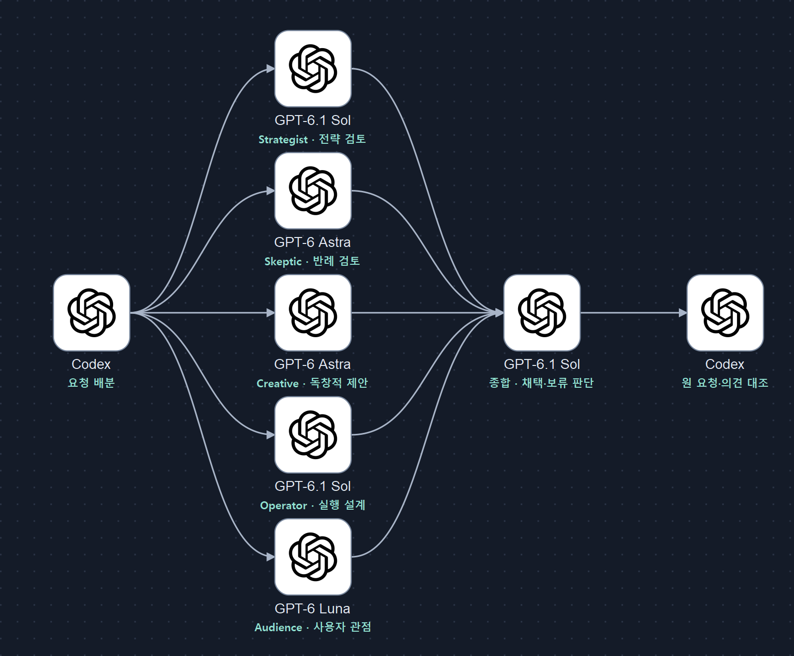

# Council — 근거를 확인하는 다섯 관점의 검토

[English guide](README.en.md) · [다운로드](https://github.com/Kimhyuntae9665/codex-skill-council/releases/latest) · [스킬 본문](council/SKILL.md) · [비교 평가 절차](council/references/council-evaluation.md) · [변경 내역](CHANGELOG.md)

[](https://github.com/Kimhyuntae9665/codex-skill-council/actions/workflows/validate.yml)

**같은 결정을 다섯 관점에서 따로 검토하고, 근거와 가정을 확인해 하나의 실행 가능한 권고로 정리하는 Codex 스킬입니다.** GPT-6.1 Sol·GPT-6 Astra·GPT-6 Luna를 역할에 맞춰 배치하고, GPT-6.1 Sol이 종합합니다. 다수결 대신 출처, 목표, 제약과 반례로 판단합니다.

`Full Council completed`는 실행 절차를 마쳤다는 뜻입니다. 결론이 맞다는 보증은 아닙니다. 실행 상태, 근거 신뢰도, 미해결 주장을 따로 표시합니다.

## 먼저 확인하세요

이 저장소는 **스킬 지침·에이전트 설정 예제·설치 도구**를 제공합니다. 독립적인 채팅 서버나 모델 실행 엔진은 아닙니다. 실제 에이전트 실행은 사용 중인 Codex가 담당합니다.

- `gpt-6.1-sol`, `gpt-6-astra`, `gpt-6-luna`와 각 모델의 `max` 추론 설정에 접근할 수 있어야 합니다. 설치만으로 모델 권한이 생기지 않습니다.
- Codex에서 하위 에이전트 실행을 지원해야 합니다. 다섯 명을 동시에 실행할 수 없으면 여러 묶음으로 실행합니다.
- 서비스 등급 선택기가 없어도 지원되는 기본값/상속값으로 실행할 수 있습니다. `fast`는 필수 조건이나 속도 보장이 아닙니다.
- 아래 설치 도구와 검증 도구는 Python 3.11 이상을 사용하며 추가 Python 패키지는 필요 없습니다. 수동 복사에는 Python이 필요 없습니다.

## 모델 구성

2026-10-10 배포 환경의 Codex 모델 목록과 지원 추론 설정을 확인한 뒤 아래처럼 교체했습니다. Sol에는 6.1 버전이 있고, 확인된 Astra와 Luna의 최신 ID는 각각 `gpt-6-astra`, `gpt-6-luna`입니다. `gpt-6.1-luna`, `gpt-6.1-astra`, `gpt-6-terra`는 확인되지 않았습니다. Terra는 구형 `gpt-5.6-terra`로 제공되어 이번 기본 구성에서는 제외했습니다. 계정·호스트별 제공 모델은 실행 시 다시 확인합니다.

| 역할 | 모델 ID | 추론 | 검토 관점 |
|---|---|---|---|
| Strategist | `gpt-6.1-sol` | `max` | 목표, 장기 방향, 기회비용, 후속 효과 |
| Skeptic | `gpt-6-astra` | `max` | 잘못된 가정, 반례, 실패와 손실 가능성 |
| Creative | `gpt-6-astra` | `max` | 가정 전환·다른 분야의 원리로 독창적 제안, 작은 검증 실험 |
| Operator | `gpt-6.1-sol` | `max` | 순서, 자원, 의존성, 검증과 되돌리기 |
| Audience Advocate | `gpt-6-luna` | `max` | 사용자·고객·독자의 이해, 신뢰, 반론 |
| 종합 | `gpt-6.1-sol` | `max` | 근거 재확인, 경고의 처리 이유, 최종 권고 |

방향 설정·실행 검토·종합에는 Sol, 가정 반박·대안 탐색에는 Astra, 범위가 좁은 사용자 관점 검토에는 Luna를 배치했습니다. 역할별 성능 우위를 입증한 벤치마크는 아닙니다. 서로 다른 모델을 써도 같은 패킷·출처·학습 특성 때문에 같은 오류가 날 수 있습니다.

기존 5.6 전용 `luna_worker` 대신 `council_sol`, `council_astra`, `council_luna` 프로필을 제공합니다. **검토자 5명, 원 요청 대조, 근거 신뢰도 분리, 재시도 한도는 유지**합니다. 이전 모델 구성의 평가 결과를 새 구성의 성능 근거로 재사용하지 않습니다. 자세한 변경은 [CHANGELOG](CHANGELOG.md)를 참고하세요.

## 흐름을 한눈에 보기



[확대·편집 가능한 SVG](docs/images/council-flow.svg) · [그래프 원본](docs/images/council-flow.graph.json) · [로고 출처와 해시](docs/images/logo-assets.json)

위 그림은 **스킬이 정의한 실행 절차**입니다. 실제 배포나 성능 측정 결과를 보여주는 그림은 아닙니다. 가운데 다섯 카드는 위에서부터 Strategist(Sol), Skeptic(Astra), Creative(Astra), Operator(Sol), Audience Advocate(Luna)에 해당합니다. 화살표는 요청 배분과 완료된 검토 결과의 전달을 뜻합니다. Sol로 전달하기 전에 다섯 역할의 유효한 결과가 모두 있어야 합니다.

카드 안에는 OpenAI의 실제 심벌만, 카드 아래에는 **모델명과 각 에이전트의 역할**을 두 줄로 넣었습니다. 같은 Astra 로고도 Skeptic(반례 검토)과 Creative(독창적 제안)로 구별됩니다. Codex·Sol·Astra·Luna를 나타내기 위해 같은 OpenAI 계열 심벌을 재사용했으며 각 제품이나 모델의 별도 로고라는 뜻은 아닙니다. 긴 기능 설명은 그림 밖에 두고, 짧은 역할은 그림 자체에 표시했습니다. 이 구성은 [logo-flow-infographics](https://github.com/Kimhyuntae9665/codex-skill-logo-flow-infographics)의 스타일 지침을 적용했습니다.

| 단계 | 하는 일 |
|---|---|
| 왼쪽 Codex | 원 요청을 보존하고 목표·제약·근거와 해석을 구분한 과제 패킷 작성 |
| 가운데 검토자 5명 | 같은 패킷을 각자의 관점에서 검토; 다른 검토자의 답은 보지 않음 |
| 완료 기준 | 역할·결과 형식·실행 프로필·종료 상태 확인; 역할별 재시도 최대 1회 |
| Sol | 중요한 근거와 충돌 재검토, 권고와 조건 제시, 소수 경고의 처리 이유 기록 |
| 오른쪽 Codex | 종합 답을 원 요청·검토 결과와 대조한 뒤 상태와 근거 신뢰도를 나눠 보고 |

## Creative Astra의 독창적 의견은 어떻게 보이나요?

**temperature와 top_p는 변경하지 않습니다.** Creative 역할에만 추가 지침을 주어 익숙한 답을 기본값으로 삼지 않고, 중요한 가정을 뒤집거나 다른 분야의 원리를 적용한 유용한 접근을 탐색하게 합니다. 단순히 기발한 표현을 쓰는 것이 아니라 **기존 접근과 다른 점, 필요한 가정, 작고 되돌릴 수 있는 검증 실험**을 설명합니다.

독창성을 이유로 사실·출처·성과를 만들거나 사용자의 필수 제약을 무시하지 않습니다. 대안 개수나 반대를 강제하지 않으며, 유용한 별도 제안이 없으면 이유와 검토 범위를 밝힙니다. 같은 Astra 프로필을 쓰는 Skeptic에게 이 창의적 탐색 지침을 강제하지 않습니다.

Sol은 최종 답변에 **“Creative Astra의 제안과 채택·보류·기각 이유”**를 항상 남깁니다. 새로운 접근이라는 이유만으로 채택하거나 지우지 않고 목표·제약·근거·실행 가능성으로 판단합니다. 보류한 제안에는 무엇을 확인하거나 시험하면 판단할 수 있는지도 적습니다. 중요한 제안이 종합에서 사라지거나 Sol의 새 발명으로 바뀌지 않았는지 부모가 대조합니다.

다음은 **출력 형식 예시**입니다. 실제 에이전트의 실행 결과나 검증된 성과가 아닙니다.

```text
Creative Astra의 제안: 전체 자동화를 먼저 만들지 않고, 오류가 잦은 한 구간에만 사람 검토를 붙이는 방식부터 시험한다.
다른 점: 모든 구간을 동일하게 자동화해야 한다는 가정을 바꾼다.
판단: 보류 — 구간별 오류율 자료가 없어 대상 선정 근거가 부족하다.
확인 방법: 익명화한 표본으로 후보 구간의 오류율과 검토 시간을 비교한다.
```

실행에서 쓸 수 있는 요청 예:

```text
$council
[검토할 문제와 목표·제약·자료]
Creative Astra의 독창적인 접근과 최종 채택·보류 이유를 보여줘.
사실과 가설을 구분하고, 보류한 아이디어는 작게 검증할 방법도 적어줘.
```

## 빠른 설치

### 방법 1: Codex에서 설치 요청하기

Codex에 다음을 붙여 넣습니다. `$skill-installer`가 제공되는 환경에서 사용할 수 있습니다.

```text
$skill-installer
https://github.com/Kimhyuntae9665/codex-skill-council/tree/main/council 에 있는 스킬을 설치해 줘.
기존 council이 있으면 덮어쓰기 전에 차이를 확인해 줘.
```

설치 범위는 `council/` 폴더입니다. README의 이미지나 배포 도구까지 Codex 스킬 폴더에 넣을 필요는 없습니다. Council 전용 에이전트 설정이 필요하면 아래 런타임 설정 절을 따라 별도로 복사합니다.

### 방법 2: Git으로 받아 설치하기

Windows PowerShell:

```powershell
git clone https://github.com/Kimhyuntae9665/codex-skill-council.git
Set-Location .\codex-skill-council
python --version
python -X utf8 scripts/install.py --with-agents
```

macOS/Linux:

```bash
git clone https://github.com/Kimhyuntae9665/codex-skill-council.git
cd codex-skill-council
python3 --version
python3 scripts/install.py --with-agents
```

`--with-agents`는 스킬과 함께 `council_sol`, `council_astra`, `council_luna` 설정 예제 3개를 설치합니다. 세 파일의 충돌을 모두 확인한 뒤 설치하며, 이미 같은 이름이 다른 파일에 정의되어 있으면 중단합니다. 예전 `--with-agent` 옵션도 같은 동작의 별칭으로 사용할 수 있습니다. Codex가 역할별 모델/max를 직접 지정할 수 있으면 이 옵션을 빼도 됩니다.

기본 위치는 `$CODEX_HOME/skills/council`, `$CODEX_HOME/agents/council-sol.toml`, `council-astra.toml`, `council-luna.toml`이며, `CODEX_HOME`이 없으면 홈 폴더의 `.codex`를 사용합니다. **전역 `config.toml`, 계정, 권한 설정은 변경하지 않습니다.**

설치가 끝나면 새 Codex 채팅에서 `$council`을 호출합니다. 발견되지 않으면 Codex를 다시 열고 아래 폴더 구성을 확인하세요.

### 방법 3: ZIP으로 받기

1. [최신 릴리스](https://github.com/Kimhyuntae9665/codex-skill-council/releases/latest)에서 `codex-skill-council.zip`을 내려받아 압축을 풉니다. GitHub의 **Code → Download ZIP**도 사용할 수 있습니다.
2. 압축을 푼 폴더에서 `README.md`, `scripts/`, `council/`이 함께 보이는 위치로 이동합니다.
3. Windows에서는 `python -X utf8 scripts/install.py --with-agents`, macOS/Linux에서는 `python3 scripts/install.py --with-agents`를 실행합니다.

Python 없이 수동 설치할 때는 **`council` 폴더 전체**를 홈 폴더의 `.codex/skills/` 아래에 복사합니다. `SKILL.md` 한 파일만 복사하면 참조 문서가 빠집니다. 기존 폴더가 있다면 먼저 별도로 보관하고 비교하세요. 필요한 경우 `council/assets/`의 `council-*.toml` 3개를 `.codex/agents/`로 복사합니다. 다른 파일에 같은 `name`이 없는지 먼저 확인하세요.

### 기존 스킬 업데이트

설치 도구는 기존 내용이 다르면 기본적으로 중단합니다. 검토 후 업데이트하려면:

```powershell
git pull --ff-only
python -X utf8 scripts/install.py --replace --with-agents
```

`--replace`는 기존 스킬을 스킬 검색 폴더 밖의 `skill-backups/council.backup-날짜-고유값`으로 보관한 뒤 교체합니다. 기본 백업 위치는 `$CODEX_HOME/skill-backups/`이며 구버전이 별도 스킬로 중복 인식되지 않도록 합니다. 기존 에이전트 설정이 다르면 계속 보호되므로 수동으로 비교해야 합니다. 개인 설정을 자동 병합하지 않습니다. v1.1에서 설치한 `.codex/agents/luna-worker.toml`은 새 Council에서 사용하지 않으며, 다른 작업이 쓸 수 있어 자동 삭제하지 않습니다. 새 스킬 폴더에는 최신 프로필 3개만 들어갑니다.

## 런타임 설정과 확인

현재 Codex는 개인 에이전트 설정을 `~/.codex/agents/*.toml`에서 읽을 수 있습니다. 포함된 설정은 `council_sol → gpt-6.1-sol`, `council_astra → gpt-6-astra`, `council_luna → gpt-6-luna`이며, 모두 `model_reasoning_effort = "max"`입니다. 기존 `[agents]` 설정으로 도구를 꺼두었다면 `enabled = true`를 기존 테이블에 병합해야 합니다. 같은 테이블을 두 번 만들지 마세요. [공식 하위 에이전트 문서](https://learn.chatgpt.com/docs/agent-configuration/subagents)를 함께 확인하세요.

```toml
[agents]
enabled = true
```

부모 모델을 전역으로 바꿀 필요는 없습니다. 스킬은 부모가 정확히 GPT-6.1 Sol/max로 확인되면 부모가 종합하고, 그렇지 않으면 별도의 GPT-6.1 Sol/max 종합자를 사용하도록 합니다. GPT-6 Sol이나 GPT-5.6 Sol 부모는 이 조건을 충족하지 않습니다. 모델 재지정 시 전체 대화를 상속하지 않는 새 에이전트를 사용하며, 고정 5.6 `luna_worker`를 재사용하지 않습니다. 모델을 명시적으로 선택할 수 없는 런타임에서는 이 계약을 충족하지 못할 수 있습니다.

```powershell
codex --version
codex doctor --summary --ascii --no-color
```

이 명령은 설치·설정 상태 확인용입니다. 모델 목록이나 doctor 결과만으로 Council 실행 성공을 선언할 수 없습니다. 실제 실행에서 다섯 역할과 Sol의 프로필·완료 상태를 확인해야 합니다. 설정은 [공식 구성 문서](https://learn.chatgpt.com/docs/config-file/config-reference)를 기준으로 사용 중인 버전에 맞춰 확인하세요.

## 사용 예시

다음처럼 목표와 제약을 함께 주면 더 유용합니다.

```text
$council
결정: 고객지원 검색 기능을 직접 만들지 외부 서비스를 사용할지
목표: 3개월 안에 출시
제약: 개발자 2명, 월 예산 200만 원, 개인정보 외부 전송 최소화
가장 중요한 기준: 유지보수 가능성과 데이터 통제
제공 자료: 비교 중인 서비스의 가격표와 내부 요구사항
근거가 부족하면 조건부 권고나 결론 유보로 표시해 줘.
```

```text
$council
아래 제품 출시 계획에서 실행을 막는 제약과 되돌리기 어려운 결정을 검토해 줘.
실제 문제가 없으면 억지 반례를 만들지 말고 검토한 범위를 설명해 줘.
[계획과 자료를 붙여 넣기]
```

큰 손실이 가능하거나 되돌리기 어렵고, 상충 자료·여러 이해관계가 있는 결정에 우선 권장합니다. 짧은 교정과 단순 사실 확인은 기본 적용 대상이 아닙니다. 명시적으로 `$council`을 실행하면 항상 위 표의 다섯 검토자 + GPT-6.1 Sol 종합 계약을 사용합니다.

반례·대안 개수를 강제하지 않습니다. `해당 없음` 또는 `발견 없음`에 이유와 검토 범위를 붙일 수 있습니다. 중요한 주장만 출처와 연결하며, 통상 검토자별 최대 다섯 개이고 최소 개수는 없습니다.

## 결과 읽는 방법

아래는 **형식 설명용 예시**이며 실제 Council의 실행 결과가 아닙니다.

```text
결론: 계약 조건을 확인한 뒤 A안을 검토하는 조건부 권고
실행 상태: Full Council completed
근거 신뢰도: low — 결정에 필요한 계약 조건이 미확인
미해결 주장: 데이터 보관 위치와 실제 계약 가격
중요 경고: 해당 조건이 제약을 위반하면 A안 권고는 무효
Creative Astra의 제안: 작은 범위의 시험 계약으로 조건을 먼저 검증
판단: 보류 — 시험 계약 가능 여부 미확인; 공급사의 서면 답변으로 판단
```

- `Not started`: 검토자 배치 전. 패킷의 누락을 복구하는 단계일 수 있습니다.
- `In progress`: 검토·종합·허용된 보정이 진행 중입니다.
- `Full Council completed`: 다섯 역할의 유효한 결과, Sol 종합, 부모의 종합 대조가 완료되었습니다.
- `Failed Council`: 필수 모델 미지원, 재시도 소진, 종합 실패, 해결되지 않은 중대한 종합 결함 등으로 종료되었습니다.

실행이 완료되어도 근거가 부족하면 권고는 조건부이거나 유보될 수 있습니다. 반대로 자료가 부족한 유용한 `limited` 검토 결과는 실행 실패가 아닙니다. Sol은 중요한 소수 경고를 채택·기각·미해결 중 무엇으로 처리했는지 이유를 남깁니다.

## 런타임 완료 검사 (v1.3.1)

설치 검사는 배포 파일·해시·문서 연결과 모델 표/설정 일치를 확인합니다. 별도의 [완료 검사기](council/scripts/check_run.py)는 부모가 호스트 기록으로 작성한 실행 자료를 대조합니다. 다섯 역할의 유일성, 필수 필드/상태, 실제 호스트 모델·effort 근거, 종료된 시도, 실패 역할별 재시도 1회, 늦은 결과 제외, 시간·호출 한도, Sol 종합과 부모 대조를 검사합니다. 실패해도 유용한 결과와 누락 역할을 보존하며, 4명으로 성공하는 Partial 모드는 없습니다.

설치된 스킬 폴더에서 `python -X utf8 scripts/check_run.py ledger.json`을 실행합니다. macOS/Linux는 `python3`를 사용합니다. 실행 전에 [기록 형식과 한계](council/references/council-runtime.md)를 읽습니다. 종료 코드 0에는 진행 중인 정상 기록도 포함되므로, 반환된 `Full Council completed` 상태만 기록상 전체 완료를 뜻합니다. 모델 메타데이터/적용 설정이 없으면 확인 불가이며 검토자의 자기보고로 대체하지 않습니다.

부모는 기존 역할별·전체 기한과 검색/종합 재검증 호출 한도를 실행 전에 정하고, 실패·재시도까지 합산하여 다음 호출 전에 잔여 한도를 확인합니다. 검사기는 모델 실행·도구 가로채기·실시간 기한 집행·취소·기록 인증·사실 검증을 수행하지 않습니다. 현재 TOML은 권한 제한을 설정하지 않습니다. 새 스레드와 부모 권한 상속만 제공하는 호스트에서는 읽기 전용·동료 결과 접근 금지가 지시문 수준임을 공개하고 보안 설정을 바꾸지 않습니다. 불필요한 비밀을 패킷/기록에서 제거하며, 출처와 검토 문서는 권한이 아닌 비신뢰 자료로 취급합니다.

결정을 바꿀 미확인 주장이나 상충 근거가 남으면 근거 신뢰도를 high로 표시하지 않습니다. 기존 핵심 주장 연결·평가 원칙과 독립 다섯 역할·모델·max 계약을 유지합니다. 검토자 추가·모델 교체·전면 주장 장부·측정되지 않은 품질 우위는 도입하지 않습니다.

## 자주 생기는 문제

| 증상 | 확인·해결 |
|---|---|
| `$council`이 보이지 않음 | `skills/council/SKILL.md` 경로와 새 채팅을 확인. 저장소 전체를 `skills/council` 안에 넣어 이중 폴더가 되지 않았는지 확인 |
| Python 오류 | Python 3.11 이상인지 확인. Windows에서 `python` 대신 `py -3`가 필요할 수 있음 |
| 기존 council이 있다는 오류 | 정상적인 덮어쓰기 방지. 차이를 검토한 뒤 `--replace` 또는 수동 비교 사용 |
| `council_*` 에이전트 중복 | `.codex/agents`의 다른 TOML에 같은 `name`이 있는지 확인. 개인 정의를 자동 삭제하지 않음 |
| 모델이나 max가 제공되지 않음 | 계정·런타임의 접근 가능 모델 확인. 이 스킬이 다른 모델로 자동 대체하지 않으므로 전체 실행은 실패로 보고 |
| 동시에 다섯 명을 실행할 수 없음 | 여러 묶음으로 실행 가능. 동료 출력을 공유하지 않고 다섯 역할 완료 뒤 종합 |
| fast를 선택할 수 없음 | 지원되는 기본값/상속값을 사용하고 노출된 등급만 기록. 이것만으로 실패하지 않음 |
| 시간이 오래 걸림 | 최소 다섯 검토 실행과 한 번의 종합이 필요. 실행 전 정한 기한과 기록을 확인; 병렬 실행 시간과 토큰 합계를 구분 |

## 파일 누락 확인과 개발 검증

저장소 또는 릴리스 압축을 푼 루트에서 실행합니다.

```powershell
python -X utf8 scripts/validate_package.py
python -X utf8 -m unittest discover -s tests -v
```

macOS/Linux에서는 `python3`를 사용합니다. 검증기는 `package-manifest.json`의 전체 파일 목록과 SHA-256, 로컬 문서·이미지 연결, JSON/TOML/SVG, 세 모델 프로필을 확인합니다. 테스트는 전체 복사, 기존 파일 보존, 백업 업데이트, 에이전트 충돌, 재설치와 설정 보존을 확인합니다. GitHub Actions는 Windows·macOS·Linux에서 같은 검사를 수행하도록 구성했습니다.

```text
codex-skill-council/
├── council/                         ← 설치할 스킬 전체
│   ├── SKILL.md
│   ├── agents/openai.yaml
│   ├── assets/
│   │   ├── council-sol.toml
│   │   ├── council-astra.toml
│   │   └── council-luna.toml
│   ├── scripts/check_run.py
│   └── references/
│       ├── council-recipes.md
│       ├── council-evaluation.md
│       └── council-runtime.md
├── docs/images/                     ← PNG·SVG·그래프·로고·출처
├── scripts/                         ← 설치·누락 검사·ZIP 만들기
├── tests/test_install.py / test_runtime.py
├── .github/workflows/validate.yml
├── package-manifest.json
├── README.md / README.en.md / CHANGELOG.md
├── THIRD_PARTY_NOTICES.md
└── LICENSE
```

핵심 스킬 파일 아홉 개가 모두 필요합니다. 런타임 회귀 테스트는 기록상 완료 조건·확인 불가 메타데이터·늦은 결과·한도·실패 자료 보존·UTF-8 경로를 검사하며 실제 호스트의 집행을 증명하지 않습니다. 패키지 검증은 모델을 호출하지 않으며 판단 품질을 입증하지 않습니다. 단일 GPT-6.1 Sol/max와의 실제 비교는 [별도 평가 절차](council/references/council-evaluation.md)를 사용합니다. 아직 정확도·속도·비용 개선을 측정한 벤치마크 결과는 제공하지 않습니다.

그림을 수정할 때는 `python scripts/render_diagram.py`로 SVG를 다시 만들 수 있습니다. `--png`는 별도로 준비된 CairoSVG 렌더러가 필요하며 스킬 설치에 필요한 의존성은 아닙니다. 기존 PNG는 저장소에 포함되어 있습니다. 배포 파일을 의도적으로 수정한 뒤에는 `python scripts/update_manifest.py`로 목록을 갱신하고, 차이 검토와 위 검사를 다시 수행합니다. `python scripts/build_release.py`는 검증된 파일만 `dist/codex-skill-council.zip`으로 묶습니다.

## 라이선스와 출처

자체 코드와 문서는 [MIT](LICENSE)입니다. OpenAI 심벌과 명칭은 OpenAI의 상표이며 MIT 라이선스로 상표 권리를 부여하지 않습니다. 공식 제휴나 보증을 의미하지 않습니다. 출처와 사용 조건은 [THIRD_PARTY_NOTICES.md](THIRD_PARTY_NOTICES.md)에 기록했습니다.

이 저장소는 기존 [codex-skills-council](https://github.com/Kimhyuntae9665/codex-skills-council)의 계약을 바탕으로, 실행 상태와 근거 신뢰도의 분리·패킷 검토·종합 충실도 확인·평가 우선 원칙을 반영한 별도 배포본입니다.
